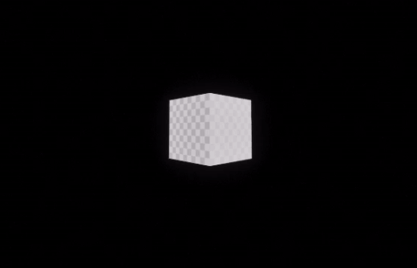
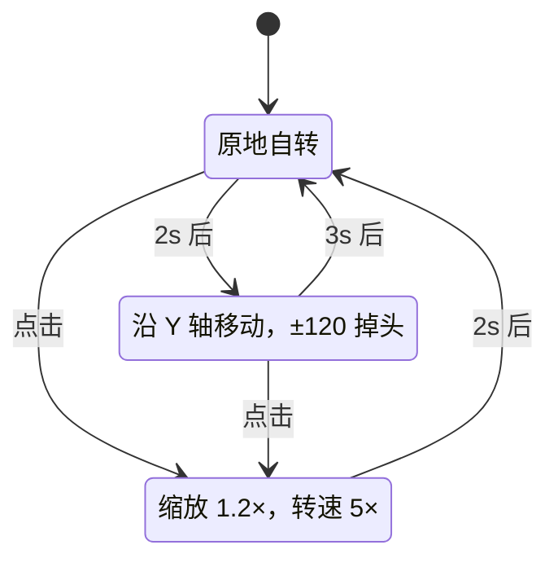

# Desktop Pet

**把一份 UE5 打包出来的游戏窗口，改造成会待在桌面上的宠物。**




---

## 这是什么

一个 Windows 桌面宠物：UE5 负责渲染与逻辑，Win32 负责把它变成"桌面上的一个窗口"。

- **无边框**：去掉标题栏与系统边框，只留一块画面
- **始终置顶**：`HWND_TOPMOST`，不被其他窗口盖住
- **半透明**：`LWA_ALPHA` 220，背景透出桌面
- **可拖动**：按住边缘区域拖走整个窗口
- **有状态**：`Idle` / `Walking` / `Happy` 三态自主切换，点击有反馈

> 说明：v0.1 是**技术验证版**，角色是一个占位方块。真实模型、动画、材质在 Roadmap 里。
>
> GIF 由 OBS 做**窗口捕获**录制，所以背景是场景的纯黑。实际运行时窗口是 `LWA_ALPHA` 半透明的，会透出桌面。

---

## 快速开始

### 环境

| 依赖 | 版本 |
| --- | --- |
| Windows | 10 / 11 |
| Unreal Engine | 5.8.3 |
| Visual Studio | 2022 或更高（需 *Game development with C++* 工作负载） |
| 磁盘 | 编译期约 12 GB（`Intermediate/` + `Binaries/` 占大头） |

### 编译

```bat
git clone https://github.com/lv-o-y/ue5-desktop-pet.git
cd ue5-desktop-pet
```

1. 右键 `MyProjects.uproject` → **Generate Visual Studio project files**
2. 打开 `MyProjects.sln`，配置选 **Development Editor / Win64**，生成
3. 双击 `MyProjects.uproject` 启动编辑器，按 **Play**

命令行编译（编辑器需先关闭，`-WaitMutex` 会互斥）：

```bat
Engine\Build\BatchFiles\Build.bat MyProjectsEditor Win64 Development ^
  -Project="<绝对路径>\MyProjects.uproject" -WaitMutex
```

### 打包

```bash
Engine\Build\BatchFiles\RunUAT.bat BuildCookRun ^
  -project="<绝对路径>\MyProjects.uproject" ^
  -noP4 -platform=Win64 -clientconfig=Development ^
  -cook -build -stage -pak -archive -archivedirectory="<输出目录>"
```

打包产物启动时是全屏/普通窗口，**窗口改造发生在 `BeginPlay`**，所以会看到它在启动后一两秒内变成桌宠外观。

---

## 项目结构

```text
MyProjects/
├── MyProjects.uproject
├── Config/
│   ├── DefaultEngine.ini        # GameDefaultMap 指向 /Game/NewMap
│   └── DefaultGame.ini
├── Content/
│   └── NewMap.umap              # 场景：一盏灯 + 宠物 Actor
└── Source/
    ├── MyProjects.Target.cs
    ├── MyProjectsEditor.Target.cs
    └── MyProjects/
        ├── MyProjects.Build.cs          # 链接 Slate / SlateCore
        ├── MyProjects.cpp / .h          # 模块入口
        └── MyActorAA2.cpp / .h          # ★ 全部逻辑在这里
```

`AMyActorAA2` 同时承担三件事：**生成自身**（Mesh 组件）、**驱动状态机**（Tick）、**改造宿主窗口**（BeginPlay 里的 Win32 代码）。

---

## 实现要点

以下几条是这个项目真正的技术内容。每条都记录了「试过什么、为什么不行、最后怎么解决」。

### 1. 从 Slate 拿到原生窗口句柄

UE 的窗口是 Slate 层的 `SWindow`，Win32 API 要的是 `HWND`，中间隔了一层：

```cpp
TSharedPtr<SWindow> Window = GEngine->GameViewport->GetWindow();
TSharedPtr<FGenericWindow> Native = Window->GetNativeWindow();
HWND hwnd = static_cast<HWND>(Native->GetOSWindowHandle());
```

`FGenericWindow` 是跨平台抽象，`GetOSWindowHandle()` 返回 `void*`，Windows 上就是 `HWND`。

**坑**：不链接 `Slate` / `SlateCore` 时，`GetNativeWindow` 链接期报 `LNK2019`。`Build.cs` 里要显式加：

```csharp
PublicDependencyModuleNames.AddRange(new string[] { "Core", "CoreUObject", "Engine", "InputCore", "Slate", "SlateCore" });
```

### 2. 去边框：清样式位，再刷新

```cpp
LONG_PTR style = GetWindowLongPtr(hwnd, GWL_STYLE);
style &= ~(WS_CAPTION | WS_THICKFRAME | WS_SYSMENU | WS_MINIMIZEBOX | WS_MAXIMIZEBOX);
style |= WS_POPUP;
SetWindowLongPtr(hwnd, GWL_STYLE, style);
SetWindowPos(hwnd, nullptr, 0, 0, 0, 0, SWP_NOMOVE | SWP_NOSIZE | SWP_NOZORDER | SWP_FRAMECHANGED);
```

`WS_CAPTION` 会画出标题栏（它本身就是 `WS_BORDER | WS_DLGFRAME` 的组合），`WS_POPUP` 声明这是弹出型窗口。只清 `WS_CAPTION` 不加 `WS_POPUP`，窗口仍带着边框；两者配合才是干净的无边框窗口。

`SWP_FRAMECHANGED` 不能漏——只改 `GWL_STYLE` 不触发重绘，窗口外观不会立即更新。

### 3. 拖动：为什么不能用 `HTCAPTION`

最省事的做法是让 `WM_NCHITTEST` 返回 `HTCAPTION`，交给系统处理拖动。**但这条路是死的**：

返回 `HTCAPTION` 后，系统会进入自己的模态拖动循环，**游戏线程在这个过程中被阻塞**。表现是：一按住窗口，宠物就僵住不动，松手才恢复。

最终改为自己实现拖动，且不进模态循环：

```cpp
case WM_LBUTTONDOWN:  // 命中标题区 → SetCapture，记录起点
case WM_MOUSEMOVE:    // 按位移调 SetWindowPos，逐帧移动
case WM_LBUTTONUP:    // ReleaseCapture
```

窗口过程通过 `SetWindowLongPtr(hwnd, GWLP_WNDPROC, ...)` 挂钩，链回原始 `WndProc`，不影响 UE 自己的消息处理。

**另一个坑**：拖动区不能是整块画面。中间区域要留给 UE 的点击交互（`bEnableClickEvents`），所以只在**顶部 40px + 四周 10px**的边框区接管拖动。另外 UE 是用 Raw Input 读鼠标的，与窗口消息是两条并行的路——整块接管会让"拖窗口"和"转视角"互相打架。

### 4. 半透明的三种方案，和为什么只能选第一种

| 方案 | API | 结果 |
| --- | --- | --- |
| 整体 alpha | `SetLayeredWindowAttributes(..., LWA_ALPHA)` | ✅ 采用。256 级整体透明度 |
| 色键 | `SetLayeredWindowAttributes(..., LWA_COLORKEY)` | ❌ 只按颜色抠，物体暗面与背景色相近，被误抠成洞 |
| 逐像素 alpha | 分层窗口 `UpdateLayeredWindow` | ❌ **UE5 独立程序根本编译不进去** |

逐像素透明失败的根因：UE5 的逐像素透明依赖 `ALPHA_BLENDED_WINDOWS` 宏，该宏在**独立（standalone / packaged）程序里为假**，相关代码整段被预处理器剔除。这是引擎构建配置层面的限制，应用层绕不过去。

**结论**：接受 `LWA_ALPHA` 的整体淡化——模型和背景一起淡。这是当前工程约束下的最优解，不是偷懒。

### 5. 输入模式：让点击落到 Actor 上

桌宠不能锁鼠标，又要能点。三处配合：

```cpp
PC->bShowMouseCursor = true;
PC->bEnableClickEvents = true;      // 允许 Actor 收到点击
PC->bEnableMouseOverEvents = true;

FInputModeGameAndUI Mode;
Mode.SetLockMouseToViewportBehavior(EMouseLockMode::DoNotLock);
Mode.SetHideCursorDuringCapture(false);
PC->SetInputMode(Mode);
```

缺任何一条，点击都会落到空白处或被视口吃掉。

---

## 状态机



状态机写在 `Tick` 里，用 `StateTimer += DeltaTime` 计时——**不是**帧数，所以换帧率动画速度不变。

---

## 已知限制

- **窗口矩形内全不透明**：方块之外的黑色区域仍然是窗口的一部分，只是整体 alpha 淡了。真正的"抠像"需要逐像素透明，UE5 独立程序不支持。
- **占位模型**：角色是 `Engine/BasicShapes/Cube`，没有美术资源。
- **单宠物**：全局 Win32 状态（`static` 变量）决定了只支持一个窗口。
- **仅 Windows**：Win32 路径不可移植。

---

## Roadmap

- [ ] **动态材质**：`Happy` 状态时用 `CreateDynamicMaterialInstance` 调颜色 / 发光，打通 C++ 与材质系统
- [ ] 骨骼动画替代缩放反馈
- [ ] 系统托盘图标 + 退出菜单（现在只能 `Alt+F4`）
- [ ] 多宠物 / 宠物间互动
- [ ] 打包体积优化（当前 Development 配置约 1 GB，Shipping 会小很多）

---

## 关于作者

生态学专业本科生，自学 UE5 与 C++，目标岗位游戏客户端开发。

这个项目的定位是**第一个完整闭环**：从建工程、写 C++、改窗口、打包、到演示视频，全流程走一遍。技术深度有限，但每一步的坑都记在 `PROGRESS.md` 里。

---

## License

[MIT](LICENSE)
